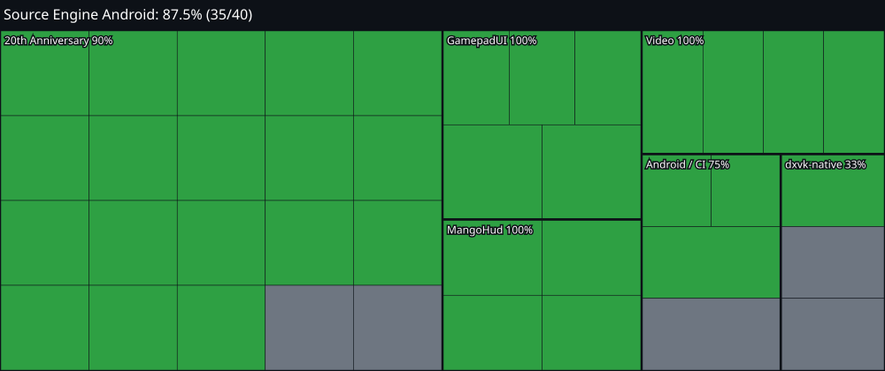

# This Repo
Based on nillerusr's source engine base, built to bring Android a SteamOS level experience, both in gameplay feel and visual polish to the Source Engine base.
Mostly vibecoded, though no trash code is making it into the repo since I actually know C++. The progress is below, also with a detailed treemap.

## Features 
- GamepadUI (`-gamepadui`) for HL2, Portal, all gamepadui assets on apk so no need for extra files
- MangoHud (`-mangohud`) exact port with all features, customizable via `mangohud.conf` in your game directory (`srceng` or your custom game files path)
- Some GamepadUI fixes (key binding fix for mouse and touch)
- (GamepadUI) Touch menu in settings instead of steam input bs
- Bink video and bink audio, valve intro (media/valve.bik) with sound, to close it `-novid` or `-nointro`
- (Can have little bugs, first version) 20th anniversary update fix: Fix Graphics, Shaders & Lighting from 20th anni. update

## Current tasks 
- dxvk-native (Tested on csso-android-enhanced. Will implement it here soon and finish it up. It has some glitches, but it boots and runs fast. Needs fixes.)
- Merged episodes

## Full Progress

# Source Engine
 
 Discord: 
 

Information from [wikipedia](https://wikipedia.org/wiki/Source_(game_engine)):

Source is a 3D game engine developed by Valve.
It debuted as the successor to GoldSrc with Half-Life: Source in June 2004,
followed by Counter-Strike: Source and Half-Life 2 later that year.
Source does not have a concise version numbering scheme; instead, it was released in incremental versions

Source code is based on TF2 2018 leak. Don't use it for commercial purposes.

This project is using waf buildsystem. If you have waf-related questions look https://waf.io/book

# Features:
- Android, OSX, FreeBSD, Windows, Linux( glibc, musl ) support
- Arm support( except windows )
- 64bit support
- Modern toolchains support
- Fixed many undefined behaviours
- Touch support( even on windows/linux/osx )
- VTF 7.5 support
- PBR support
- bsp v19-v21 support( bsp v21 support is partial, portal 2 and csgo maps works fine )
- mdl v46-49 support
- Removed useless/unnecessary dependencies
- Achivement system working without steam
- Fixed many bugs
- Serverbrowser works without steam

# Current tasks
- Rewrite materialsystem for OpenGL render
- dxvk-native support
- Elbrus port
- Bink audio support( for video_bink )

# How to Build?
- [Building instructions(EN)](https://github.com/nillerusr/source-engine/wiki/Source-Engine-(EN))
- [Building instructions(RU)](https://github.com/nillerusr/source-engine/wiki/Source-Engine-(RU))

# Support me
BTC: `bc1qnjq92jj9uqjtafcx2zvnwd48q89hgtd6w8a6na`

ETH: `0x5d0D561146Ed758D266E59B56e85Af0b03ABAF46`

XMR: `48iXvX61MU24m5VGc77rXQYKmoww3dZh6hn7mEwDaLVTfGhyBKq2teoPpeBq6xvqj4itsGh6EzNTzBty6ZDDevApCFNpsJ`
